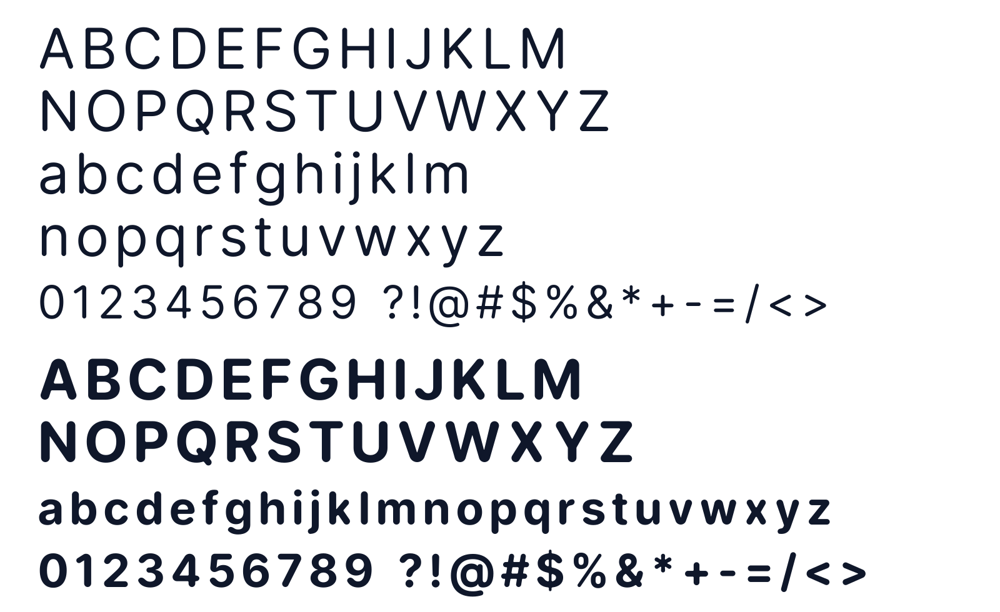

# Collab Sans



**Collab Sans** is a clean, warm neo-grotesque rounded typeface family derived from Rasmus Andersson's open-source **Inter** typeface. Designed by **Yugal** using **Antigravity**, Collab Sans combines the rigorous screen readability and micro-typography of Inter with precision tangent-continuous semicircular stroke terminals and proportional inner junction fillets.

Collab Sans is published under the [SIL Open Font License 1.1](OFL.txt) and is ready for desktop publishing, mobile applications, web design, and submission to the **Google Fonts** catalog.

---

## Font Family Overview

* **Designers**: Yugal (rounded geometry & maintainer); Rasmus Andersson (original Inter design)
* **Weights**: 9 weights (`100` Thin to `900` Black)
* **Styles**: Upright & Matching Italic (18 styles total)
* **Glyph Count**: 2,548 glyphs per font
* **Formats**: TTF (TrueType), OTF (OpenType CFF), WOFF2 (Web Open Font Format 2)
* **Character Sets**: Latin Extended, Cyrillic Extended, Greek, Vietnamese, Punctuation, Mathematical & Technical Symbols, Currency Signs

### Weight Matrix

| Weight | CSS Weight | Upright Filename | Italic Filename |
| :--- | :---: | :--- | :--- |
| **Thin** | `100` | `CollabSans-Thin.ttf` | `CollabSans-ThinItalic.ttf` |
| **ExtraLight** | `200` | `CollabSans-ExtraLight.ttf` | `CollabSans-ExtraLightItalic.ttf` |
| **Light** | `300` | `CollabSans-Light.ttf` | `CollabSans-LightItalic.ttf` |
| **Regular** | `400` | `CollabSans-Regular.ttf` | `CollabSans-Italic.ttf` |
| **Medium** | `500` | `CollabSans-Medium.ttf` | `CollabSans-MediumItalic.ttf` |
| **SemiBold** | `600` | `CollabSans-SemiBold.ttf` | `CollabSans-SemiBoldItalic.ttf` |
| **Bold** | `700` | `CollabSans-Bold.ttf` | `CollabSans-BoldItalic.ttf` |
| **ExtraBold** | `800` | `CollabSans-ExtraBold.ttf` | `CollabSans-ExtraBoldItalic.ttf` |
| **Black** | `900` | `CollabSans-Black.ttf` | `CollabSans-BlackItalic.ttf` |

---

## Geometric Rounding Highlights

* **Tangent-Continuous Semicircular Caps**: Stroke ends are rounded with tangent-continuous semicircular geometry ($R = 0.50 \times W$), ensuring authentic circular caps across horizontal, vertical, diagonal, and $9.4^\circ$ italic terminals.
* **Proportional Inner Concave Fillets**: Inner corner junctions utilize proportional fillets ($R = 0.14 \times W$) with shortest-chain ink-trap preservation, preventing optical clogging at text sizes while rendering smoothly in large display titles.
* **Sub-Contour Adaptive Scaling**: Accents, diacritical marks, punctuation dots, superscripts, subscripts, and small symbol elements adapt their rounding radii to local stroke widths.
* **Full OpenType Feature Preservation**: Complete layout tables (`GPOS`, `GSUB`, `GDEF`), tabular figures (`tnum`), slashed zero (`zero`), fractions (`frac`), and stylistic sets (`ss01`–`ss04`, `cv01`–`cv11`) are fully functional.

---

## Webfont Usage

Include `collab-sans.css` in your HTML:

```html
<link rel="stylesheet" href="path/to/collab-sans.css">
```

Apply in CSS:

```css
body {
  font-family: 'Collab Sans', -apple-system, BlinkMacSystemFont, sans-serif;
  font-weight: 400;
}

h1, h2, h3 {
  font-family: 'Collab Sans', sans-serif;
  font-weight: 700;
}
```

---

## Interactive Specimen

Open `index.html` in any web browser to preview and test all weights, adjust font size, line-height, and explore the interactive typography laboratory.

---

## License & Legal

Collab Sans is released under the **SIL Open Font License, Version 1.1** (with Reserved Font Name "Collab Sans").

* **Free for Personal & Commercial Use**: You can use Collab Sans in personal projects, commercial client branding, websites, software applications, mobile apps, and printed materials free of charge.
* **Redistribution**: You are free to redistribute and bundle Collab Sans with any software.
* **Selling Restrictions**: The font files themselves cannot be sold standalone.
* See [OFL.txt](OFL.txt) for full legal text.
